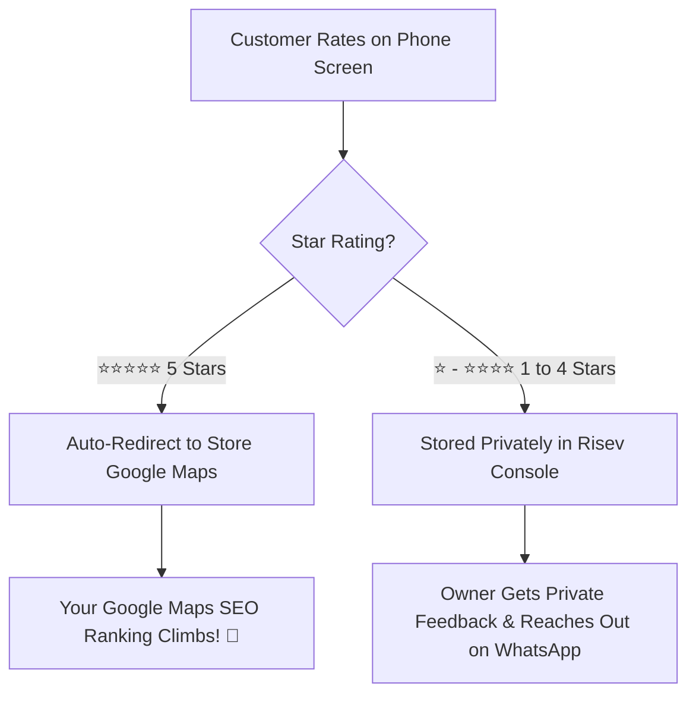

# Automated 5-Star Google Reviews

High Google Maps ratings are the #1 magnet for attracting new walk-in customers. Risev features an intelligent **Smart Review Funnel** that automatically screens customer satisfaction before routing reviews.

<VideoTutorial 
  title="Automating 5-Star Google Reviews" 
  subtitle="45-second tutorial on boosting your Google Maps rankings automatically."
  duration="0:45 mins"
/>

---

## How the Smart Review Funnel Works 🧠

Each time a customer collects a stamp, the app prompts:  
*"How was your experience with us today?"*

* **If Customer Gives 5 Stars:**  
  Risev instantly redirects them to your official Google Maps "Write a Review" page with 5 stars pre-selected. Your public Google rating skyrockets!
* **If Customer Gives 1 to 4 Stars (Constructive Feedback):**  
  Risev **NEVER** sends them to Google. Instead, their feedback is kept private in your merchant console. You can reach out directly via WhatsApp to resolve complaints before they harm your public reputation.

---

## Connecting Your Google Review Link

1. Open **Google Maps** on your phone or computer.
2. Search for your business profile.
3. Click **"Ask for reviews"** or copy your listing share link (e.g. `https://maps.app.goo.gl/...`).
4. In the Risev Merchant Console, go to **Profile > Onboarding Setup**.
5. Paste your link into the **Google Review URL** field.
6. **Smart Auto-Resolver:** Risev automatically detects the link and converts it into the official Google Write-Review API link!
7. Click **"Save Changes"**.
