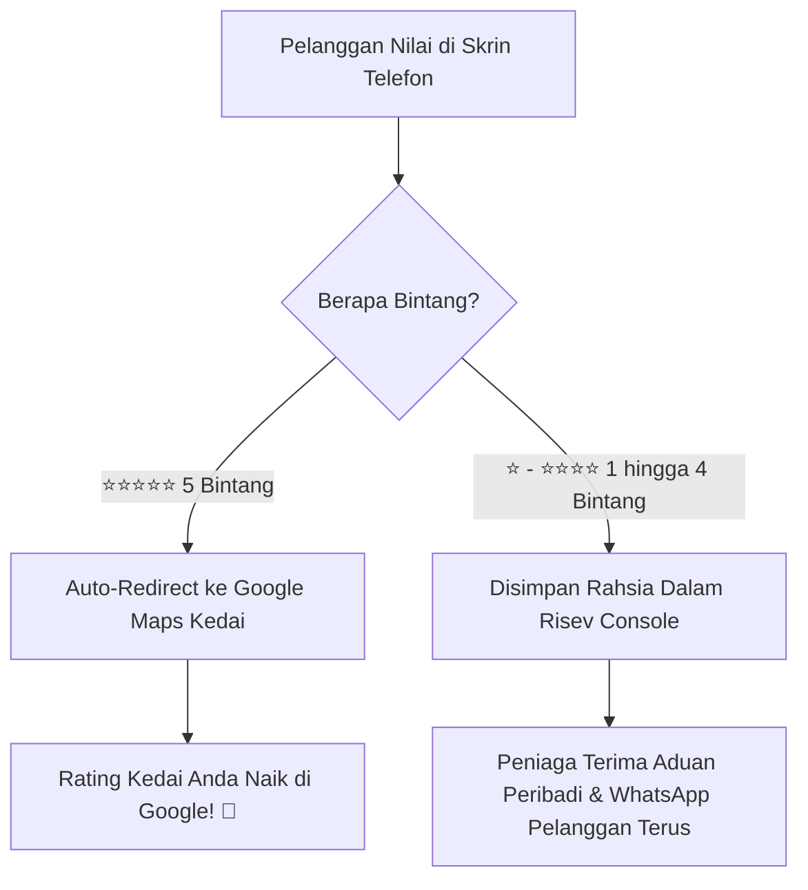

# Setup Google Review 5-Bintang

Ulasan Google Maps yang tinggi adalah magnet nombor 1 untuk menarik pelanggan baharu secara percuma. Sistem Risev mempunyai **Smart Review Funnel** pintar yang menapis kepuasan pelanggan secara automatik.

<VideoTutorial 
  title="Cara Jana Ulasan Google 5-Bintang Automatik" 
  subtitle="Tutorial 45 saat: Bagaimana Risev menaikkan rating kedai anda di Google Maps."
  duration="0:45 minit"
/>

---

## Bagaimana "Smart Review Funnel" Risev Berfungsi? 🧠

Setiap kali pelanggan selesai mengumpul cop di kaunter, sistem akan bertanya:  
*"Bagaimanakah pengalaman anda di kedai kami hari ini?"*

* **Jika Pelanggan Beri 5 Bintang:**  
  Sistem Risev serta-merta membuka aplikasi Google Maps dan mengisi borang ulasan 5-bintang untuk kedai anda. Rating Google anda melonjak tinggi!
* **Jika Pelanggan Beri 1 hingga 4 Bintang (Kurang Puas Hati):**  
  Sistem **TIDAK AKAN** menghantar mereka ke Google Maps. Sebaliknya, maklum balas mereka disimpan secara tertutup di portal peniaga Risev. Anda boleh WhatsApp mereka secara peribadi untuk menyelesaikan masalah sebelum reputasi awam kedai anda terjejas.

---

## Cara Dapatkan & Masukkan Pautan Google Review

1. Buka aplikasi **Google Maps** di telefon anda atau di komputer.
2. Cari nama kedai anda.
3. Tekan butang **"Ask for reviews"** (Minta ulasan) atau salin pautan kongsi kedai anda (contoh pautan: `https://maps.app.goo.gl/...` atau `https://g.page/...`).
4. Buka aplikasi Peniaga Risev > pergi ke **Profil > Onboarding Setup**.
5. Tampal pautan Google Maps tersebut di ruangan **Google Review URL**.
6. **Auto-Resolver Ajaib:** Sistem Risev akan mengesan pautan tersebut secara automatik dan menukarnya menjadi *Direct Write-Review Link* rasmi!
7. Tekan butang **"Save Changes"**.
